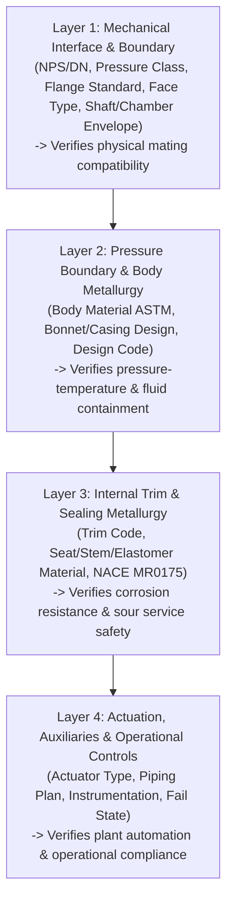
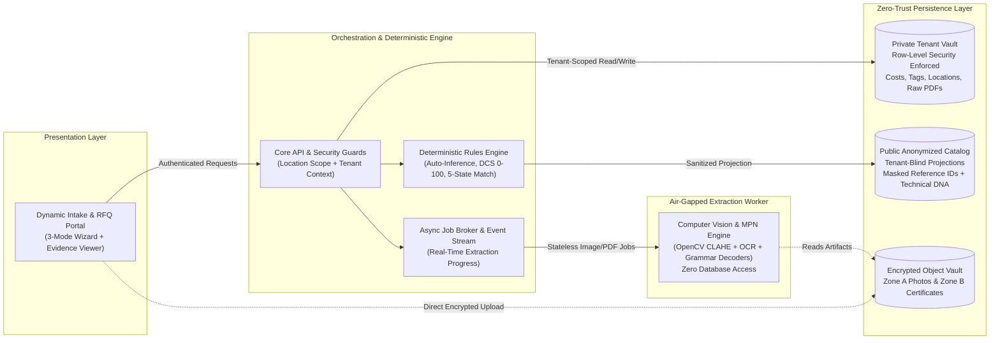
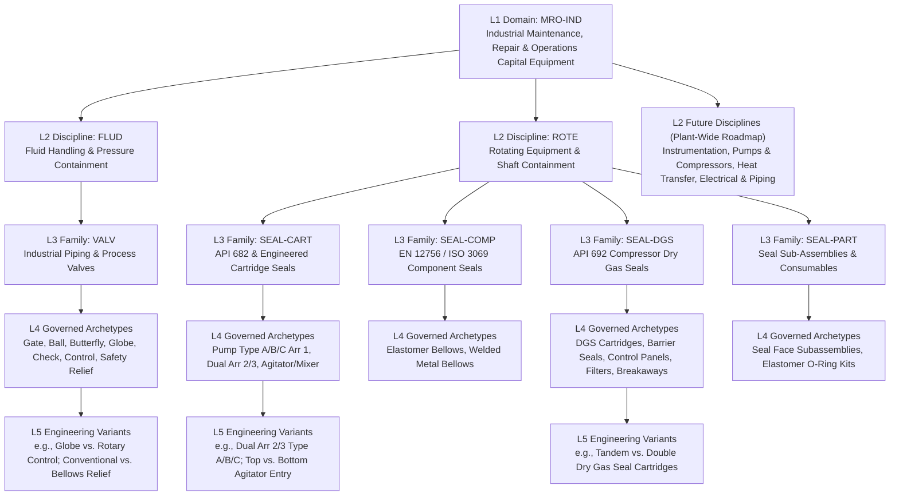
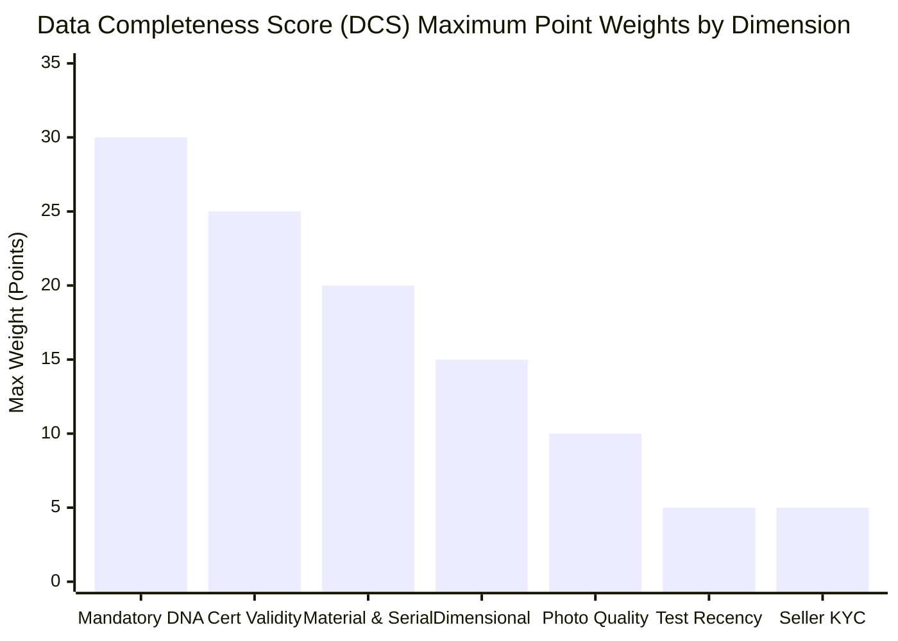
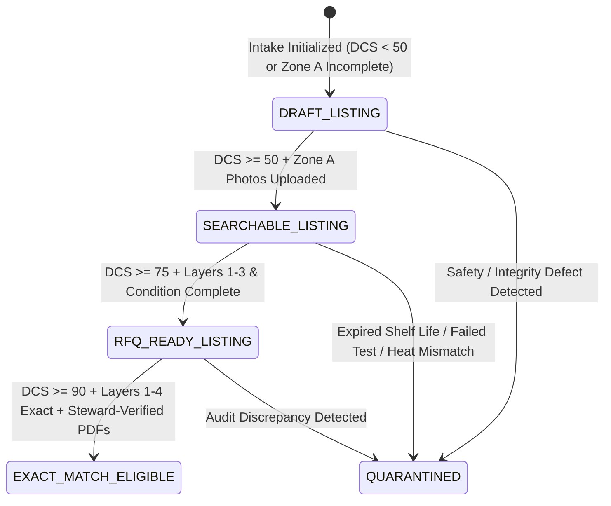
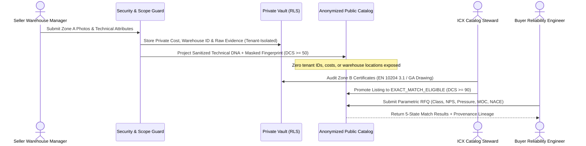

# ICX — Industrial Circular Exchange

### *An Evidence-Backed, Deterministic Engineering Clearinghouse for Critical-Path Plant Equipment Across Heavy Process & Manufacturing Industries*

 

 
<b>Figure 1:</b> Unified Step 1 Intake — Mode A (Zone A/B Artifact Dropzone &amp; 3-Angle Guided Blueprint Stencil), Mode B (&lt;50 ms OEM Figure Number Decoder), and Mode C (Visual L2 &rarr; L4 Class Selector).

---

> [!NOTE]
> **Academic & Portfolio Showcase Repository**
> This repository presents the architectural design, domain taxonomy, safety invariants, and engineering workflows of the **ICX (Industrial Circular Exchange)** platform. In accordance with intellectual property and commercial confidentiality policies, proprietary source code, internal schemas, and deployment configurations are maintained in a private repository.

---

## Abstract

Capital-intensive industrial plants—spanning **Oil & Gas**, **Petrochemicals & Refining**, **Fertilizers**, **Power Generation**, **Mining & Metallurgy**, and **Heavy Manufacturing**—face a structural supply-chain paradox: billions of dollars in brand-new, unused critical-path spare parts remain stranded in project and turnaround warehouses, while active facilities endure unplanned outages costing **\$100,000 to \$1,000,000 per day** due to **30-to-52-week** Original Equipment Manufacturer (OEM) lead times. Conventional B2B e-commerce marketplaces rely on unstructured text search and probabilistic similarity, which are fundamentally unsafe for engineered plant equipment operating in toxic ($\text{H}_2\text{S}$), high-pressure (Class 2500), or cryogenic ($-196^\circ\text{C}$) service.

**ICX (Industrial Circular Exchange)** resolves this challenge by transforming unstructured warehouse artifacts—physical nameplate photographs, cast body stamps, OEM General Arrangement (GA) drawings, and EN 10204 3.1 Mill Test Certificates—into a **deterministic, evidence-backed engineering source of truth**. Built around **Rule 0 (Strict Abstention)**, an **extensible 5-level industrial MRO taxonomy (`L1–L5`)**, a **4-layer progressive clarification pipeline**, and **5-state deterministic compatibility evaluation**, ICX is architected to scale across **all plant disciplines and industrial archetypes**, enabling reliability engineers to procure verified surplus equipment with mathematical and regulatory certainty while preserving strict multi-tenant data sovereignty.

---

## Table of Contents

1. [Problem Statement & Industrial Motivation](#1-problem-statement--industrial-motivation)
2. [Core Engineering Philosophy & Safety Invariants](#2-core-engineering-philosophy--safety-invariants)
3. [System Architecture & Trust Boundaries](#3-system-architecture--trust-boundaries)
4. [The ICX 5-Level Industrial Taxonomy (`L1` → `L5`)](#4-the-icx-5-level-industrial-taxonomy-l1--l5)
5. [Multi-Modal Intake & Computer Vision Pipeline](#5-multi-modal-intake--computer-vision-pipeline)
6. [Deterministic Matching, Auto-Inference & Completeness Scoring](#6-deterministic-matching-auto-inference--completeness-scoring)
7. [Multi-Tenant Data Sovereignty & Provenance Governance](#7-multi-tenant-data-sovereignty--provenance-governance)
8. [Verification Methodology & Platform Capabilities](#8-verification-methodology--platform-capabilities)

---

## 1. Problem Statement & Industrial Motivation

### The Stranded Capital vs. Critical Downtime Paradox

| Industrial Challenge | Operational Reality | Consequence of Status Quo |
| :--- | :--- | :--- |
| **Dormant Capital Inventory** | EPC contractors and plant operators accumulate unused, project-surplus equipment after capital construction and maintenance turnarounds. | High-value assets depreciate indefinitely in storage yards with fragmented ERP descriptions and missing traceability. |
| **Unplanned Shutdown Exposure** | A single failed high-pressure isolation valve, compressor dry gas seal, or critical rotating assembly can halt an entire process train. | **30–52 week** OEM manufacturing lead times result in **\$100K–\$1M/day** in lost production. |
| **Failure of Keyword Marketplaces** | Generic e-commerce platforms match listings using free-text keywords or fuzzy vector embeddings. | Physically incompatible or metallurgically unsafe substitutions introduce catastrophic safety and environmental risks. |

### Why Probabilistic Text Matching Is Unacceptable in Process Engineering

In heavy process and manufacturing facilities, minor specification discrepancies represent non-negotiable failure modes:
- **Mating Geometry Mismatch:** A 6-inch Class 300 Raised Face (RF) valve cannot bolt leak-free to a Ring-Type Joint (RTJ) flange, and an ASME B16.47 Series A flange has an incompatible bolt circle with Series B.
- **Functional Archetype Confusion:** Substituting a standard globe isolation valve for a stop-check non-return globe valve causes reverse-flow hydraulic hazards.
- **Metallurgical & Sour Service Risk:** Installing carbon steel without NACE MR0175 / ISO 15156 hardness control ($\le 22\text{ HRC}$) in $\text{H}_2\text{S}$ service triggers sulfide stress cracking (SSC) and potential lethal release.

---

## 2. Core Engineering Philosophy & Safety Invariants

Every algorithmic decision, data model, and user workflow in ICX is governed by strict safety invariants designed to eliminate guesswork.

> [!IMPORTANT]
> **Rule 0 — Strict Abstention ("Missing Is Always Better Than a Guess")**
> Neither the optical extraction pipeline nor the matching engine is permitted to interpolate, assume, or hallucinate missing engineering parameters. Any attribute not explicitly proven by a physical nameplate, catalog grammar, or certified test report is recorded as `UNKNOWN` and automatically routed to human engineering review—never to an approximate match.

### The 4-Layer Progressive Clarification Pipeline

Industrial component qualification is structured into four hierarchical engineering layers. Lower layers govern physical interface and pressure-containment feasibility before internal trim or actuation options are evaluated:

### Core Architectural Principles

1. **Mutually Exclusive Archetypes:** Cross-class automatic matching is strictly forbidden (`DISQ-L0-01`). Distinct mechanical archetypes—such as floating vs. trunnion ball valves or single vs. dual pressurized seals—are never auto-substituted across class boundaries.
2. **Absolute Mating Compatibility:** Components that cannot physically mate under design pressure are immediately disqualified (`DISQ-L1-01` through `DISQ-L1-03`).
3. **Datasheet $\neq$ Physical Proof of Stock:** Manufacturer PDF catalogs describe generic design specifications, not physical warehouse possession. Live marketplace publication always requires physical photographic evidence.
4. **Controlled OEM Part Number Guardrails:** Free-text descriptions are prohibited in part-number fields; manufacturers are selected from a controlled registry and part numbers undergo strict structural normalization.

---

## 3. System Architecture & Trust Boundaries

ICX employs a **decoupled, service-oriented architecture** that isolates untrusted optical compute, deterministic engineering rules, and multi-tenant transactional storage across strict network and privilege boundaries.

### Key Architectural Characteristics

- **Compile-Time Schema Governance:** Equipment class specifications and shared engineering tables are authored as declarative registries and compiled at build time into strongly typed validation contracts, UI metadata manifests, and strict extraction schemas—eliminating runtime configuration parsing errors.
- **Air-Gapped AI Compute:** The optical extraction and MPN decoding microservice holds zero database credentials and no direct route to transactional storage, ensuring pure stateless computation.
- **Event-Driven Extraction Feedback:** Long-running computer vision tasks execute asynchronously via message queues and stream granular stage transitions (`PREPROCESSING_IMAGE` $\rightarrow$ `CLASSIFYING_PART` $\rightarrow$ `EXTRACTING_4_LAYER_DNA` $\rightarrow$ `EXTRACTION_COMPLETE`) back to the user interface in real time.

---

## 4. The ICX 5-Level Industrial Taxonomy (`L1` → `L5`)

Rather than relying on flat e-commerce categories, ICX is built on a **hierarchical, extensible 5-Level Industrial MRO Taxonomy** designed to expand across **all plant disciplines and heavy industrial sectors**. New equipment families and archetypes are onboarded declaratively into the master taxonomy without altering core matching or security engines.

### Taxonomy Hierarchy Semantics

| Level | Tier Name | Engineering Role |
| :---: | :--- | :--- |
| **`L1`** | **Industrial Domain (`MRO-IND`)** | Unified industrial capital spare-parts domain spanning Oil & Gas, Petrochemicals, Refining, Fertilizers, Power Generation, Mining, and Heavy Manufacturing. |
| **`L2`** | **Engineering Discipline** | Broad plant engineering domain (e.g., `FLUD` Fluid Handling & Pressure Containment, `ROTE` Rotating Equipment & Shaft Containment, expanding to Instrumentation, Power, and Thermal Systems). |
| **`L3`** | **Equipment Family** | Functional equipment family sharing macro standards (e.g., `VALV`, `SEAL-CART`, `SEAL-COMP`, `SEAL-DGS`, `SEAL-PART`). |
| **`L4`** | **Governed Archetype** | Mutually exclusive engineering design archetype with dedicated sealing/flow physics, 4-Layer Technical DNA schema, and strict no-cross-match isolation (`DISQ-L0-01`). |
| **`L5`** | **Engineering Variant** | Specialized operational sub-configuration inheriting its parent L4 schema while tightening variant-specific mechanical constraints. |

### Declared Foundation Disciplines, Families & Archetypes

The initial production taxonomy anchors two mission-critical plant disciplines—**Fluid Handling (`FLUD`)** and **Rotating Equipment (`ROTE`)**—establishing the template for full-plant expansion:

#### Discipline 1: Fluid Handling & Pressure Containment (`FLUD`)

| L3 Family | Equipment Sub-Category | L4 Governed Class Codes | Declared L5 Engineering Variants | Governing Standards |
| :--- | :--- | :--- | :--- | :--- |
| **`VALV`** | **Gate Valves** | `FLUD-VALV-GATE-FLGD` *(Flanged Cast)* `FLUD-VALV-GATE-FRGD` *(Forged Small-Bore)* `FLUD-VALV-GATE-PSEL` *(Pressure Seal Bonnet)* `FLUD-VALV-GATE-SLAB` *(Through-Conduit Slab)* | — | API 600, API 602, API 6D, ASME B16.34, ASME B16.10 |
| **`VALV`** | **Ball Valves** | `FLUD-VALV-BALL-FLOT` *(Floating)* `FLUD-VALV-BALL-TRUN-PIPE` *(Pipeline Trunnion)* `FLUD-VALV-BALL-TRUN-PROC` *(Process Trunnion)* | — | API 6D, ISO 17292, ASME B16.34, API 607 / ISO 10497 |
| **`VALV`** | **Butterfly Valves** | `FLUD-VALV-BFLY-DOBV` *(Double-Offset)* `FLUD-VALV-BFLY-TOV` *(Triple-Offset)* | — | API 609, ASME B16.34, ISO 10497 |
| **`VALV`** | **Globe Valves** | `FLUD-VALV-GLOB-ISOL` *(Bolted Bonnet Isolation)* `FLUD-VALV-GLOB-STCK` *(Stop-Check Non-Return)* | — | BS 1873, API 623, API 602, ASME B16.34 |
| **`VALV`** | **Check Valves** | `FLUD-VALV-CHCK-SWNG` *(Swing Check)* `FLUD-VALV-CHCK-DUAL` *(Dual-Plate Check)* | — | API 594, BS 1868, API 6D, ASME B16.34 |
| **`VALV`** | **Modulating Control Valves** | `FLUD-VALV-CTRL-MODU` *(Modulating Control)* | `FLUD-VALV-CTRL-MODU-GLOB` *(Globe)* `FLUD-VALV-CTRL-MODU-ROTR` *(Rotary)* | IEC 60534, ISA-75, ANSI/FCI 70-2 |
| **`VALV`** | **Pressure Safety & Relief Valves** | `FLUD-VALV-PRSV-SPRG` *(Direct Spring-Loaded)* `FLUD-VALV-PRSV-PILO` *(Pilot-Operated)* | `FLUD-VALV-PRSV-SPRG-CONV` *(Conventional)* `FLUD-VALV-PRSV-SPRG-BELW` *(Balanced Bellows)* `FLUD-VALV-PRSV-PILO-POP` *(Pop-Action)* `FLUD-VALV-PRSV-PILO-MODU` *(Modulating)* | API 520, API 526, API 527, ASME BPVC Sec. VIII |

#### Discipline 2: Rotating Equipment & Shaft Containment (`ROTE`)

| L3 Family | Equipment Sub-Category | L4 Governed Class Codes | Declared L5 Engineering Variants | Governing Standards |
| :--- | :--- | :--- | :--- | :--- |
| **`SEAL-CART`** | **Pump Cartridge Seals** | `MECH-SEAL-PUMP-A-ARR1` *(Type A, Arr 1)* `MECH-SEAL-PUMP-B-ARR1` *(Type B, Arr 1)* `MECH-SEAL-PUMP-C-ARR1` *(Type C, Arr 1)* `MECH-SEAL-PUMP-DUAL-ARR2` *(Dual Arr 2)* `MECH-SEAL-PUMP-DUAL-ARR3` *(Dual Arr 3)* | `MECH-SEAL-PUMP-{A,B,C}-ARR2` `MECH-SEAL-PUMP-{A,B,C}-ARR3` | API 682 / ISO 21049, EN 12756 |
| **`SEAL-CART`** | **Agitator & Reactor Seals** | `MECH-SEAL-AGIT-MIXG` *(Agitator & Mixer Seals)* | `MECH-SEAL-AGIT-MIXG-TOP` *(Top-Entry)* `MECH-SEAL-AGIT-MIXG-BTM` *(Bottom-Entry)* | DIN 28138, API 682 |
| **`SEAL-COMP`** | **Component Seals** | `MECH-SEAL-COMP-ELAS` *(Elastomer Bellows)* `MECH-SEAL-COMP-WBDG` *(Welded Metal Bellows)* | — | EN 12756, ISO 3069 |
| **`SEAL-DGS`** | **Dry Gas Sealing Systems** | `MECH-SEAL-DGS-CART` *(Compressor DGS Cartridges)* `MECH-SEAL-DGS-SPRT` *(Separation Barrier Seals)* `MECH-SEAL-DGS-CTRL` *(DGS Control Panels)* `MECH-SEAL-DGS-FILT` *(DGS Filter Elements)* `MECH-SEAL-DGS-ACCS` *(DGS Accessories & Breakaways)* | `MECH-SEAL-DGS-CART-TAND` *(Tandem)* `MECH-SEAL-DGS-CART-DBLE` *(Double)* | API 692, API 617 |
| **`SEAL-PART`** | **Sub-Assemblies & Kits** | `MECH-SEAL-SUB-FACE` *(Seal Face Subassemblies)* `MECH-SEAL-CONS-ELAS` *(Elastomer O-Ring Kits)* | — | ISO 2230, ISO 3601 / SAE AS568 |

### Multi-Industry Expansion Roadmap & Enterprise Crosswalks

- **Plant-Wide Extensibility:** Because every class specification is purely declarative, the taxonomy is engineered to onboard additional industrial plant disciplines—including **Centrifugal & Positive-Displacement Pumps**, **Process Instrumentation & Field Transmitters**, **Compressors & Turbines**, **Heat Exchangers & Pressure Vessels**, **Industrial Electrical & Switchgear**, and **Specialty Piping & Filtration**—across Oil & Gas, Power, Mining, Water Treatment, and Discrete Manufacturing.
- **Automated Enterprise Crosswalks:** Every governed asset maps deterministically to global procurement and asset-management taxonomies, including **UNSPSC**, **ECLASS**, **ISO 14224**, **CFIHOS**, and **Harmonized System (HS)** customs codes, alongside **NACE MR0175 / ISO 15156**, **NACE MR0103**, and **EN 10204 3.1 / 3.2** metallurgical traceability.

---

## 5. Multi-Modal Intake & Computer Vision Pipeline

To eliminate manual data-entry friction while enforcing strict evidentiary proof, sellers enter spare parts through a **Unified 5-Step Intake Workflow** featuring **three convergent Step 1 intake modes** on a single screen:

### Low-Friction Evidence Policy: Zone A vs. Zone B

To balance warehouse usability with anti-counterfeit protection, ICX separates physical proof from engineering certifications:

| Evidence Zone | Purpose | Requirement Level | Representative Artifacts |
| :--- | :--- | :--- | :--- |
| **Zone A (Physical Proof)** | Confirms physical custody, nameplate legibility, heat-code marking, and preservation condition. | **Mandatory to Publish** (2–3 smartphone photos) | Nameplate Macro Photo, Body Heat-Stamp Photo, Flange / Seal Face Photo, Elastomer Cure Bag Photo |
| **Zone B (Certification Boosters)** | Confirms metallurgical chemistry, factory test pressure, and exact dimensional envelope. | **Optional at Intake** (unlocks `EXACT_MATCH_ELIGIBLE` upon Steward audit) | EN 10204 3.1/3.2 Mill Test Certificate, OEM GA Drawing PDF, Hydrostatic Test Report, Fire-Safe / Fugitive Emission Certs |

### Optical Pre-Processing & Deterministic MPN Grammars

- **Industrial Image Enhancement:** Physical nameplates in refineries and storage yards frequently suffer from corrosion, oil film, glare, and low-contrast stamped lettering. The vision pipeline applies **OpenCV CLAHE (Contrast Limited Adaptive Histogram Equalization)**, perspective deskewing, and glare suppression prior to spatial OCR bounding-box extraction.
- **OEM Figure Number Decoding (`< 50 ms`):** Industrial Manufacturer Part Numbers encode dense mechanical specifications (equipment type, port geometry, pressure class, body alloy, end connection, and trim). Deterministic regex grammar decoders extract 60–75% of Layers 1–3 instantaneously across controlled OEMs as well as EN 12756 and API 682 seal designations.

---

## 6. Deterministic Matching, Auto-Inference & Completeness Scoring

### Standard-Locked Deterministic Auto-Inference

When primary attributes are verified, ICX's deterministic inference engine derives mathematically locked secondary parameters directly from international standard tables—never via probabilistic guessing:

- **Dimensional & Flange Cross-Inference:** Bidirectional `NPS` $\leftrightarrow$ `DN` conversion (`ASME B36.10M` / `ISO 6708`), `ASME B16.5` flange assignment for $\text{NPS} \le 24$, `ASME B16.10` face-to-face dimensions, `API 6D` minimum full-port bores, `API 526` safety relief orifice areas, and `EN 12756` mechanical seal cavity dimensions.
- **Pressure-Temperature & Metallurgy Tables:** `ASME B16.34` material group mapping, temperature bounds, and linear P-T curve interpolation; `API 600` seat-insert inference from trim codes.
- **Elastomer Shelf-Life Calculation:** Automated expiration computation per **ISO 2230** from cure-quarter markings and polymer chemistry (`NBR` = 5 yrs, `EPDM/HNBR` = 7 yrs, `FKM/FEPM/FFKM` = 10 yrs, `PTFE` = 15 yrs), alongside `SAE AS568` O-ring cross-sectional geometry.

### Data Completeness Score (`DCS 0–100`) & 5-Stage Lifecycle Gating

Every asset receives a dynamic **Data Completeness Score (`0–100`)** weighted across seven positive quality dimensions and one duplicate-risk penalty:

> **Note:** Individual class governance profiles tune exact sub-weights (`20–25` for certificates, `15–20` for material/serial traceability, `10–15` for dimensional consistency, `0–5` for inspection recency) normalized to a `0–100` scale, while duplicate inventory detections apply a `-25` point penalty.

The `DCS` score, Zone A photo status, and automated safety rules govern progression across **5 deterministic lifecycle stages**:

### 5-State Deterministic Match Evaluation

When a Buyer Reliability Engineer submits a parametric Request for Quotation (RFQ), every candidate asset evaluates deterministically into exactly one state:

| Match State | Engineering Criteria | Procurement Action |
| :--- | :--- | :--- |
| **`EXACT`** | 100% parameter alignment across Layers 1–3 with Steward-verified certificates and Zone A proof. | Eligible for immediate purchase order execution. |
| **`ENGINEERING_EQUIVALENT`** | Candidate safely exceeds buyer specification without altering mating geometry or process chemistry (e.g., 316SS upgrade over 304SS, Stellite 6 hardfacing, higher pressure rating with matching envelope). | Approved match accompanied by an automated engineering upgrade notice and reliability sign-off. |
| **`REVIEW_REQUIRED`** | Compatible Layer 1 physical interface, but secondary documentation, hydrotest recency ($\gt 24\text{–}36$ months), or unverified attributes require sign-off. | Routed to Catalog Steward or Buyer Reliability Engineer for evidence review. |
| **`DISQUALIFIED`** | Hard physical, metallurgical, or regulatory incompatibility (class mismatch, incompatible flange standard, lower pressure class, missing NACE sour qualification). | Excluded with explicit engineering reason codes. |
| **`QUARANTINED`** | Heat-number contradiction between photo and MTC, uncertified repair history, severe outdoor corrosion, failed hydrotest/borescope, or expired elastomer shelf life. | Locked in Private Vault; completely hidden from marketplace search. |

---

## 7. Multi-Tenant Data Sovereignty & Provenance Governance

### Dual-Table Isolation & Kernel-Level Privacy

Industrial sellers require absolute confidentiality over purchase costs, warehouse bin locations, and internal plant asset tags. ICX enforces privacy at the database kernel level:

1. **Private Inventory Vault:** Protected by **PostgreSQL Row-Level Security (RLS)** running under an unprivileged application role without bypass privileges, combined with facility-level **Location Scope Guards** restricting every user strictly to their assigned warehouses.
2. **Anonymized Public Catalog:** Upon publication, private metadata is stripped and projected into a tenant-blind catalog identified solely by cryptographically masked item fingerprints and verified technical DNA.

### Controlled Data Provenance Hierarchy

Every individual technical attribute stored in an asset's profile carries an explicit provenance lineage across **17 controlled data sources**, organized into three confidence tiers:

| Confidence Tier | Representative Sources | Trust Semantics |
| :--- | :--- | :--- |
| **Tier 1: `SELF_DECLARED`** | Manual Wizard Entry, ERP Inventory Export, Generic OEM Catalog | Lowest authority; routes high-consequence parameters to `REVIEW_REQUIRED`. |
| **Tier 2: `PHYSICALLY_VERIFIED`** | Nameplate Macro Photo OCR, Body Heat-Stamp Photo, OEM GA Drawing, Physical Inspection | Medium-high authority; visually anchored to physical bounding-box evidence. |
| **Tier 3: `MTR_AUTHENTICATED` / `STEWARD_AUDITED`** | EN 10204 3.1/3.2 Mill Test Certificate, Hydrostatic Test Sheet, Authorized OEM Confirmation, Steward Audit | Highest non-repudiable authority; required for `EXACT` match eligibility. |

---

## 8. Verification Methodology & Platform Capabilities

To uphold safety-critical reliability across every governed archetype, the platform is continuously validated through a multi-gate automated verification methodology:

| Verification Gate | Verification Focus |
| :--- | :--- |
| **Per-Class Taxonomy Vector Suite** | Validates exact schemas, draft `UNKNOWN` abstention, structural rejection, and deterministic completeness across every governed class. |
| **Matching & Workflow Simulation Suite** | Verifies 5-state match outcomes, Rule 0 abstention, standard-locked auto-inference, DCS scoring, and automated quarantine triggers. |
| **Multi-Tenant Security Isolation Suite** | Proves kernel-level PostgreSQL Row-Level Security prevents cross-tenant data leakage under unprivileged database roles. |
| **MPN Grammar Verification Suite** | Validates sub-50 ms deterministic part-number parsing accuracy and strict abstention on malformed or ambiguous catalog strings. |

---

### Summary of Platform Capabilities

| Dimension | Specification |
| :--- | :--- |
| **Target Industries** | Oil & Gas, Petrochemicals, Fertilizers, Power Generation, Mining, Heavy Manufacturing |
| **Taxonomy Architecture** | Extensible 5-Level Industrial MRO Hierarchy (`L1–L5`) Across All Plant Disciplines |
| **Safety Standard** | Rule 0 Strict Abstention + 5-State Deterministic Match Evaluation |
| **Intake Experience** | 3-Mode Convergent Step 1 (AI Photo/PDF Dropzone, `<50 ms` MPN Decoder, Guided Class Picker) |
| **Data Sovereignty** | Dual-Table Private/Public Isolation + PostgreSQL RLS + Location Scope Enforcement |

 

<b>ICX — Industrial Circular Exchange</b> &bull; Proprietary Engineering Architecture &amp; Domain Specification Showcase

