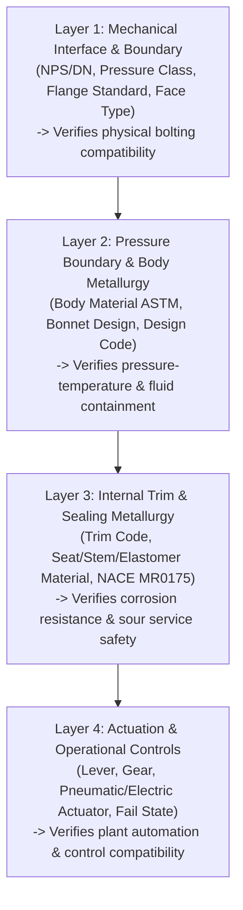
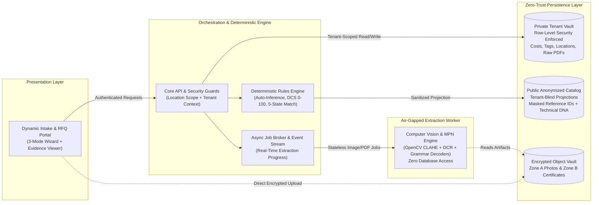
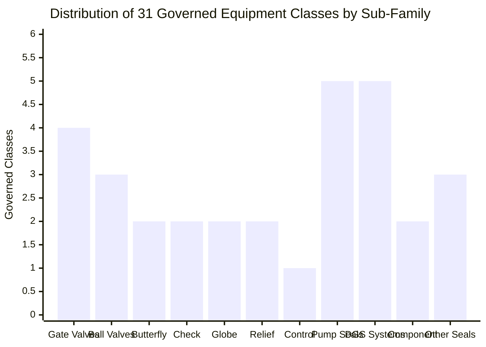
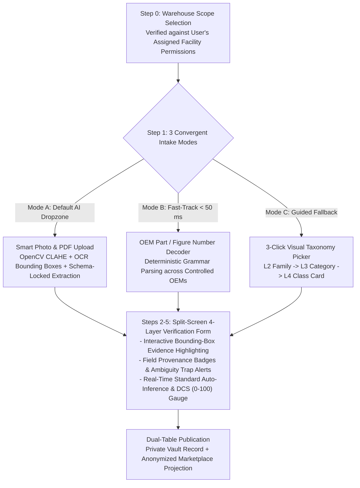
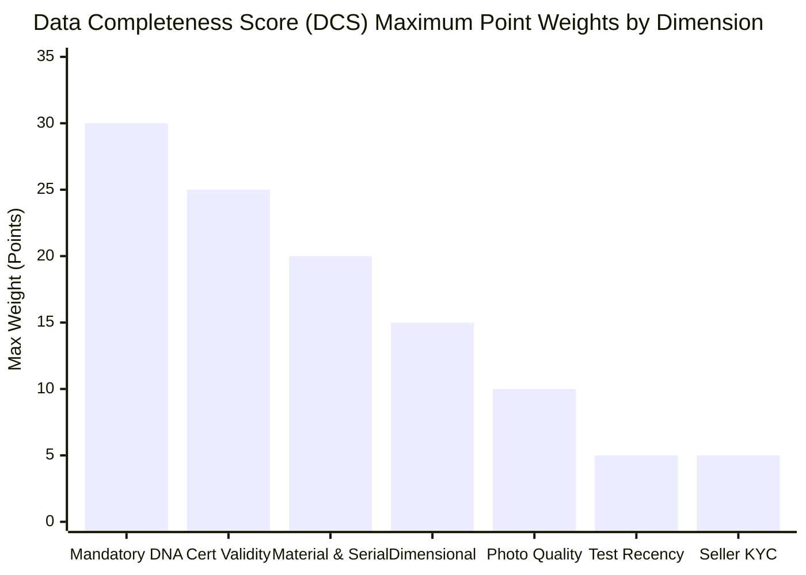
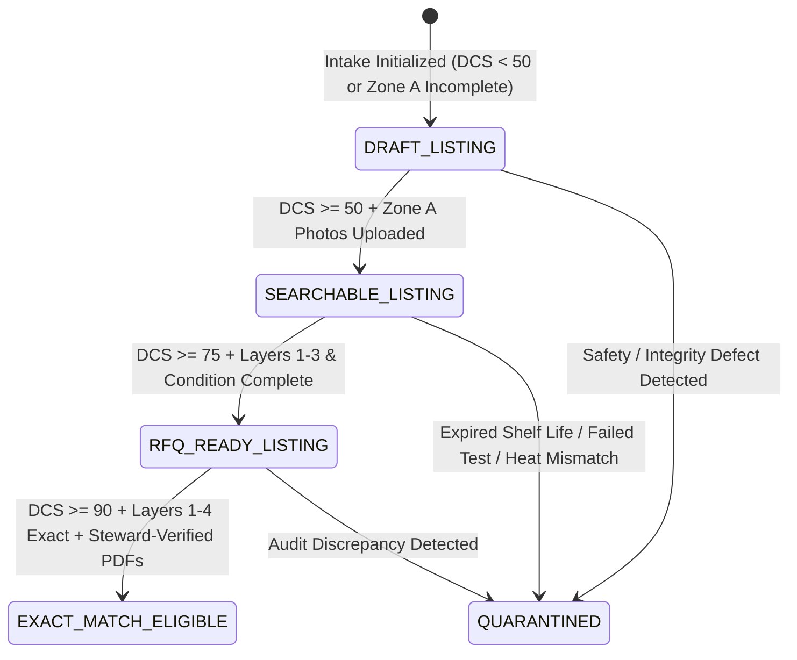
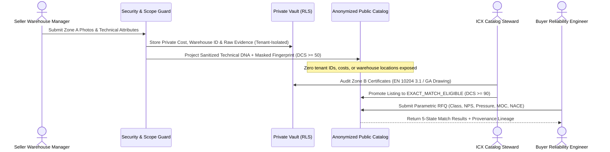

# ICX — Industrial Circular Exchange

### *An Evidence-Backed, Deterministic Engineering Clearinghouse for Critical-Path Industrial Surplus Equipment*

 

 
<b>Figure 1:</b> Unified Step 1 Intake — Mode A (Zone A/B Artifact Dropzone &amp; 3-Angle Guided Blueprint Stencil), Mode B (&lt;50 ms OEM Figure Number Decoder), and Mode C (Visual L2 &rarr; L4 Class Selector).

---

> [!NOTE]
> **Academic & Portfolio Showcase Repository**
> This repository presents the architectural design, domain engineering methodology, safety invariants, and system workflows of the **ICX (Industrial Circular Exchange)** platform. In accordance with intellectual property and commercial confidentiality policies, proprietary source code, internal schemas, and deployment configurations are maintained in a private repository.

---

## Abstract

Heavy process industries—including **Oil & Gas**, **Petrochemicals**, **Fertilizers**, and **Power Generation**—face a dual structural inefficiency: billions of dollars in brand-new, unused capital spare parts remain stranded in project warehouses, while active facilities suffer unplanned shutdowns costing **\$100,000 to \$1,000,000 per day** due to **30-to-52-week** Original Equipment Manufacturer (OEM) lead times. Conventional B2B e-commerce marketplaces rely on unstructured text search and probabilistic similarity, which are fundamentally unsafe for pressure-retaining equipment operating in toxic ($\text{H}_2\text{S}$), high-pressure (Class 2500), or cryogenic ($-196^\circ\text{C}$) service.

**ICX (Industrial Circular Exchange)** resolves this challenge by transforming unstructured warehouse artifacts—physical nameplate photographs, cast body stamps, OEM General Arrangement (GA) drawings, and EN 10204 3.1 Mill Test Certificates—into a **deterministic, evidence-backed engineering source of truth**. Built around **Rule 0 (Strict Abstention)**, a **31-class domain taxonomy**, a **4-layer progressive clarification pipeline**, and **5-state deterministic compatibility evaluation**, ICX enables plant reliability engineers to procure verified surplus equipment with mathematical and regulatory certainty while preserving strict multi-tenant data sovereignty.

---

## Table of Contents

1. [Problem Statement & Industrial Motivation](#1-problem-statement--industrial-motivation)
2. [Core Engineering Philosophy & Safety Invariants](#2-core-engineering-philosophy--safety-invariants)
3. [System Architecture & Trust Boundaries](#3-system-architecture--trust-boundaries)
4. [Governed Equipment Taxonomy & International Standards](#4-governed-equipment-taxonomy--international-standards)
5. [Multi-Modal Intake & Computer Vision Pipeline](#5-multi-modal-intake--computer-vision-pipeline)
6. [Deterministic Matching, Auto-Inference & Completeness Scoring](#6-deterministic-matching-auto-inference--completeness-scoring)
7. [Multi-Tenant Data Sovereignty & Provenance Governance](#7-multi-tenant-data-sovereignty--provenance-governance)
8. [Verification Methodology & Key System Metrics](#8-verification-methodology--key-system-metrics)

---

## 1. Problem Statement & Industrial Motivation

### The Stranded Capital vs. Critical Downtime Paradox

| Industrial Challenge | Operational Reality | Consequence of Status Quo |
| :--- | :--- | :--- |
| **Dormant Capital Inventory** | EPC contractors and plant operators accumulate unused, project-surplus valves and mechanical seals after capital turnarounds. | High-value assets depreciate in storage yards with fragmented ERP descriptions and missing traceability. |
| **Unplanned Shutdown Exposure** | A single failed Class 600 stop-check valve or compressor dry gas seal can halt an entire process train. | **30–52 week** OEM manufacturing lead times result in **\$100K–\$1M/day** in lost production. |
| **Failure of Keyword Marketplaces** | Generic e-commerce platforms match listings using free-text keywords or fuzzy vector embeddings. | Physically incompatible or metallurgically unsafe substitutions introduce catastrophic safety risks. |

### Why Probabilistic Text Matching Is Unacceptable in Process Engineering

In heavy industrial piping and rotating machinery, minor specification discrepancies are non-negotiable failure modes:
- **Flange Geometry Mismatch:** A 6-inch Class 300 Raised Face (RF) valve cannot bolt leak-free to a Ring-Type Joint (RTJ) flange, and an ASME B16.47 Series A flange has an incompatible bolt circle with Series B.
- **Functional Archetype Confusion:** Substituting a standard globe isolation valve for a stop-check non-return globe valve causes reverse-flow hydraulic hazards.
- **Metallurgical & Sour Service Risk:** Installing carbon steel without NACE MR0175 / ISO 15156 hardness control ($\le 22\text{ HRC}$) in $\text{H}_2\text{S}$ service triggers sulfide stress cracking (SSC) and potential lethal release.

---

## 2. Core Engineering Philosophy & Safety Invariants

Every algorithmic decision, data model, and user workflow in ICX is governed by strict safety invariants designed to eliminate guesswork.

> [!IMPORTANT]
> **Rule 0 — Strict Abstention ("Missing Is Always Better Than a Guess")**
> Neither the optical extraction pipeline nor the matching engine is permitted to interpolate, assume, or hallucinate missing engineering parameters. Any attribute not explicitly proven by a physical nameplate, catalog grammar, or certified test report is recorded as `UNKNOWN` and automatically routed to human engineering review—never to an approximate match.

### The 4-Layer Progressive Clarification Pipeline

Industrial component qualification is structured into four hierarchical engineering layers. Lower layers govern physical and pressure-containment feasibility before internal trim or actuation options are evaluated:

### Core Architectural Principles

1. **Mutually Exclusive Archetypes:** Cross-class automatic matching is strictly forbidden (`DISQ-L0-01`). A floating ball valve can never auto-match a trunnion-mounted ball valve or a gate valve.
2. **Absolute Mating Compatibility:** Components that cannot physically mate under design pressure are immediately disqualified (`DISQ-L1-01` through `DISQ-L1-03`).
3. **Datasheet $\neq$ Physical Proof of Stock:** Manufacturer PDF catalogs describe generic design specifications, not physical warehouse possession. Live marketplace publication always requires physical photographic evidence.
4. **Controlled OEM Part Number Guardrails:** Free-text descriptions are prohibited in part-number fields; manufacturers are selected from a controlled registry and part numbers undergo strict structural normalization.

---

## 3. System Architecture & Trust Boundaries

ICX employs a **decoupled, service-oriented architecture** that isolates untrusted optical compute, deterministic engineering rules, and multi-tenant transactional storage across strict network and privilege boundaries.

### Key Architectural Characteristics

- **Compile-Time Schema Governance:** All 31 equipment classes and shared engineering tables are authored as declarative specifications and compiled at build time into strongly typed validation contracts, UI metadata manifests, and strict extraction schemas—eliminating runtime configuration parsing errors.
- **Air-Gapped AI Compute:** The optical extraction and MPN decoding microservice holds zero database credentials and no direct route to transactional storage, ensuring pure stateless computation.
- **Event-Driven Extraction Feedback:** Long-running computer vision tasks execute asynchronously via message queues and stream granular stage transitions (`PREPROCESSING_IMAGE` $\rightarrow$ `CLASSIFYING_PART` $\rightarrow$ `EXTRACTING_4_LAYER_DNA` $\rightarrow$ `EXTRACTION_COMPLETE`) back to the user interface in real time.

---

## 4. Governed Equipment Taxonomy & International Standards

ICX governs **31 distinct industrial equipment archetypes** partitioned across two high-consequence equipment families: **16 Fluid Process Valve classes** and **15 Mechanical Seal & Dry Gas Seal (DGS) classes**.

### Equipment Family Coverage

| Equipment Family | Sub-Categories Covered | Class Count | Primary Governing Standards |
| :--- | :--- | :---: | :--- |
| **Process Valves** | Flanged Cast Gate, Forged Small-Bore Gate, Pressure Seal Gate, Slab Gate, Floating & Trunnion Ball, Double/Triple-Offset Butterfly, Swing & Dual-Plate Check, Isolation & Stop-Check Globe, Modulating Control, Spring & Pilot Safety Relief | **16** | ASME B16.34, ASME B16.5 / B16.47, ASME B16.10, API 6D, API 600, API 602, API 520/526/527, API 598, IEC 60534, ANSI/FCI 70-2 |
| **Mechanical Seals & DGS Systems** | API 682 Pump Cartridges (Types A/B/C, Arrangements 1/2/3), Elastomer & Welded Metal Bellows Component Seals, Agitator/Reactor Seals, Compressor Dry Gas Seal Cartridges, Separation Barrier Seals, DGS Control & Filter Units, Seal Face Subassemblies, Elastomer O-Ring Kits | **15** | API 682 / ISO 21049, API 692, API 617, EN 12756, DIN 28138, ISO 2230, ISO 3601 / SAE AS568 |

### Cross-Domain Regulatory & Enterprise Interoperability

- **Metallurgy & Sour Service Compliance:** NACE MR0175 / ISO 15156, NACE MR0103 / ISO 17945, and EN 10204 Type 3.1 / 3.2 Mill Test Certificates.
- **Automated Enterprise Crosswalks:** Every governed asset maps deterministically to global procurement and asset-management taxonomies, including **UNSPSC**, **ECLASS**, **ISO 14224**, **CFIHOS**, and **Harmonized System (HS)** customs codes.

---

## 5. Multi-Modal Intake & Computer Vision Pipeline

To eliminate manual data-entry friction while enforcing strict evidentiary proof, sellers enter spare parts through a **Unified 5-Step Intake Workflow** featuring **three convergent Step 1 intake modes** on a single screen:

### Low-Friction Evidence Policy: Zone A vs. Zone B

To balance warehouse usability with anti-counterfeit protection, ICX separates physical proof from engineering certifications:

| Evidence Zone | Purpose | Requirement Level | Representative Artifacts |
| :--- | :--- | :--- | :--- |
| **Zone A (Physical Proof)** | Confirms physical custody, nameplate legibility, heat-code marking, and preservation condition. | **Mandatory to Publish** (2–3 smartphone photos) | Nameplate Macro Photo, Body Heat-Stamp Photo, Flange / Seal Face Photo, Elastomer Cure Bag Photo |
| **Zone B (Certification Boosters)** | Confirms metallurgical chemistry, factory test pressure, and exact dimensional envelope. | **Optional at Intake** (unlocks `EXACT_MATCH_ELIGIBLE` upon Steward audit) | EN 10204 3.1/3.2 Mill Test Certificate, OEM GA Drawing PDF, Hydrostatic Test Report, Fire-Safe / Fugitive Emission Certs |

### Optical Pre-Processing & Deterministic MPN Grammars

- **Industrial Image Enhancement:** Physical nameplates in refineries and storage yards frequently suffer from corrosion, oil film, glare, and low-contrast stamped lettering. The vision pipeline applies **OpenCV CLAHE (Contrast Limited Adaptive Histogram Equalization)**, perspective deskewing, and glare suppression prior to spatial OCR bounding-box extraction.
- **OEM Figure Number Decoding (`< 50 ms`):** Industrial Manufacturer Part Numbers encode dense mechanical specifications (valve family, port type, pressure class, body alloy, end connection, and API trim). Deterministic regex grammar decoders extract 60–75% of Layers 1–3 instantaneously across controlled OEMs (e.g., Velan, Kitz, Emerson Fisher/Crosby, John Crane, EagleBurgmann, Flowserve, Cameron WKM) as well as EN 12756 and API 682 seal designations.

---

## 6. Deterministic Matching, Auto-Inference & Completeness Scoring

### Standard-Locked Deterministic Auto-Inference

When primary attributes are verified, ICX's deterministic inference engine derives mathematically locked secondary parameters directly from international standard tables—never via probabilistic guessing:

- **Dimensional & Flange Cross-Inference:** Bidirectional `NPS` $\leftrightarrow$ `DN` conversion (`ASME B36.10M` / `ISO 6708`), `ASME B16.5` flange assignment for $\text{NPS} \le 24$, `ASME B16.10` face-to-face dimensions, `API 6D` minimum full-port bores, `API 526` safety relief orifice areas, and `EN 12756` mechanical seal cavity dimensions.
- **Pressure-Temperature & Metallurgy Tables:** `ASME B16.34` material group mapping, temperature bounds, and linear P-T curve interpolation; `API 600` seat-insert inference from trim codes.
- **Elastomer Shelf-Life Calculation:** Automated expiration computation per **ISO 2230** from cure-quarter markings and polymer chemistry (`NBR` = 5 yrs, `EPDM/HNBR` = 7 yrs, `FKM/FEPM/FFKM` = 10 yrs, `PTFE` = 15 yrs), alongside `SAE AS568` O-ring cross-sectional geometry.

### Data Completeness Score (`DCS 0–100`) & 5-Stage Lifecycle Gating

Every asset receives a dynamic **Data Completeness Score (`0–100`)** weighted across seven positive quality dimensions and one duplicate-risk penalty:

> **Note:** Individual class governance profiles tune exact sub-weights (`20–25` for certificates, `15–20` for material/serial traceability, `10–15` for dimensional consistency, `0–5` for inspection recency) normalized to a `0–100` scale, while duplicate inventory detections apply a `-25` point penalty.

The `DCS` score, Zone A photo status, and automated safety rules govern progression across **5 deterministic lifecycle stages**:

### 5-State Deterministic Match Evaluation

When a Buyer Reliability Engineer submits a parametric Request for Quotation (RFQ), every candidate asset evaluates deterministically into exactly one state:

| Match State | Engineering Criteria | Procurement Action |
| :--- | :--- | :--- |
| **`EXACT`** | 100% parameter alignment across Layers 1–3 with Steward-verified certificates and Zone A proof. | Eligible for immediate purchase order execution. |
| **`ENGINEERING_EQUIVALENT`** | Candidate safely exceeds buyer specification without altering mating geometry or process chemistry (e.g., 316SS upgrade over 304SS, Stellite 6 hardfacing, higher pressure rating with matching envelope). | Approved match accompanied by an automated engineering upgrade notice. |
| **`REVIEW_REQUIRED`** | Compatible Layer 1 physical interface, but secondary documentation, hydrotest recency ($\gt 24\text{–}36$ months), or unverified attributes require sign-off. | Routed to Catalog Steward or Buyer Reliability Engineer for evidence review. |
| **`DISQUALIFIED`** | Hard physical, metallurgical, or regulatory incompatibility (class mismatch, incompatible flange standard, lower pressure class, missing NACE sour qualification). | Excluded with explicit engineering reason codes. |
| **`QUARANTINED`** | Heat-number contradiction between photo and MTC, uncertified repair history, severe outdoor corrosion, failed hydrotest/borescope, or expired elastomer shelf life. | Locked in Private Vault; completely hidden from marketplace search. |

---

## 7. Multi-Tenant Data Sovereignty & Provenance Governance

### Dual-Table Isolation & Kernel-Level Privacy

Industrial sellers require absolute confidentiality over purchase costs, warehouse bin locations, and internal plant asset tags. ICX enforces privacy at the database kernel level:

1. **Private Inventory Vault:** Protected by **PostgreSQL Row-Level Security (RLS)** running under an unprivileged application role without bypass privileges, combined with facility-level **Location Scope Guards** restricting every user strictly to their assigned warehouses.
2. **Anonymized Public Catalog:** Upon publication, private metadata is stripped and projected into a tenant-blind catalog identified solely by cryptographically masked item fingerprints and verified technical DNA.

### Controlled Data Provenance Hierarchy

Every individual technical attribute stored in an asset's profile carries an explicit provenance lineage across **17 controlled data sources** (`SRC-01` through `SRC-18`), organized into three confidence tiers:

| Confidence Tier | Representative Sources | Trust Semantics |
| :--- | :--- | :--- |
| **Tier 1: `SELF_DECLARED`** | Manual Wizard Entry, ERP Inventory Export, Generic OEM Catalog | Lowest authority; routes high-consequence parameters to `REVIEW_REQUIRED`. |
| **Tier 2: `PHYSICALLY_VERIFIED`** | Nameplate Macro Photo OCR, Body Heat-Stamp Photo, OEM GA Drawing, Physical Inspection | Medium-high authority; visually anchored to physical bounding-box evidence. |
| **Tier 3: `MTR_AUTHENTICATED` / `STEWARD_AUDITED`** | EN 10204 3.1/3.2 Mill Test Certificate, Hydrostatic Test Sheet, Authorized OEM Confirmation, Steward Audit | Highest non-repudiable authority; required for `EXACT` match eligibility. |

---

## 8. Verification Methodology & Key System Metrics

To uphold safety-critical reliability without exposing production source code, the engineering platform is validated continuously through a multi-gate deterministic verification suite:

| Verification Gate | Coverage Scope | Verification Focus |
| :--- | :--- | :--- |
| **Taxonomy Vector Suite** | **124 validation vectors** (`31 classes × 4 vectors`) | Enforces valid exact schemas, draft `UNKNOWN` abstention, and structural rejection across all 31 classes. |
| **Matching & Workflow Suite** | **30 end-to-end simulation tests** | Verifies 5-state match outcomes, Rule 0 abstention, deterministic auto-inference, DCS 0–100 scoring, and quarantine triggers. |
| **Multi-Tenant Security Suite** | **11 database isolation tests** | Proves kernel-level PostgreSQL Row-Level Security prevents cross-tenant leakage under unprivileged roles. |
| **MPN Grammar Suite** | **8 OEM decoder suites** | Validates sub-50 ms parsing accuracy and strict abstention on malformed or ambiguous catalog strings. |

---

### Summary of Platform Capabilities

| Dimension | Specification |
| :--- | :--- |
| **Target Industries** | Oil & Gas, Petrochemicals, Fertilizers, Power Generation, Heavy Refining |
| **Governed Equipment** | 31 Mutually Exclusive Classes (16 Process Valves + 15 Mechanical & Dry Gas Seals) |
| **Safety Standard** | Rule 0 Strict Abstention + 5-State Deterministic Match Evaluation |
| **Intake Experience** | 3-Mode Convergent Step 1 (AI Photo/PDF Dropzone, `<50 ms` MPN Decoder, Guided Class Picker) |
| **Data Sovereignty** | Dual-Table Private/Public Isolation + PostgreSQL RLS + Location Scope Enforcement |

 

<b>ICX — Industrial Circular Exchange</b> &bull; Proprietary Engineering Architecture &amp; Domain Specification Showcase

